# Autovermietung

**Nicht kommerzielles Full-Stack-Portfolio-Projekt.**

Die Anwendung demonstriert den Ablauf einer Autovermietung mit folgenden Funktionen:
- Chatfenster mit LLM basierte Suche für Fragen zu den bereitgestellten Dokumenten
- Fahrzeugsuche
- Reservierung
- Bezahlung
- Versand von Bestätigungen und Rechnungen per E-Mail

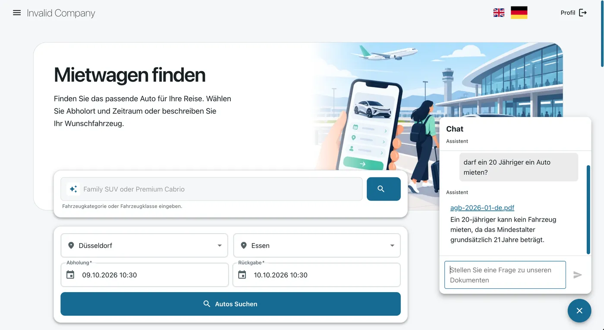

# Inhaltsverzeichnis
- [Funktionen](#funktionen)
- [Screenshots](#screenshots)
  -  [Fragen zu Dokumenten](#fragen-zu-dokumenten)
  - [Startseite](#startseite)
  - [LLM basierte Suche](#llm-basierte-suche)
  - [PayPal-Bezahlung](#paypal-bezahlung)
  - [Chrome developers](#chrome-developers)
- [Technik und Aufbau](#technik-und-aufbau)
- [Lokal starten](#lokal-starten)
  - [Voraussetzungen und Konfiguration](#voraussetzungen-und-konfiguration)
  - [Stage-Stack starten](#stage-stack-starten)
  - [Registrierung und Anmeldung](#registrierung-und-anmeldung)
  - [LLM einrichten](#llm-einrichten)
  - [Dienste beenden](#dienste-beenden)
- [RAG-Dokumente und Benachrichtigungen](#rag-dokumente-und-benachrichtigungen)
- [Tests und Performance](#tests-und-performance)
- [Rechte und Lizenzen](#rechte-und-lizenzen)

## Funktionen

- Fahrzeugsuche nach Standort und Zeitraum sowie LLM basierte Suche
- Reservierungen mit Kilometerpaketen, Extras und Preisübersicht
- Anmeldung über Keycloak, Nutzerprofil und Übersicht eigener Reservierungen
- Chat mit Retrieval-Augmented Generation (RAG)
- PayPal-Sandbox-Anbindung, E-Mail-Benachrichtigungen und Rechnungs-PDFs
- Deutsche und englische Oberfläche mit hellem und dunklem Farbschema
- Administrationsseiten für KI-Konfiguration und RAG-Dokumente
- Kontaktformular mit ALTCHA zum Schutz vor automatisierten Anfragen

## Screenshots

### Fragen zu Dokumenten

Im Chat können Fragen zu den bereitgestellten Dokumenten gestellt werden. Die Antwort verweist auf die PDF, in der die Information steht.


### Startseite

Die Autovermietung unterstützt Lightmode und Darkmode.

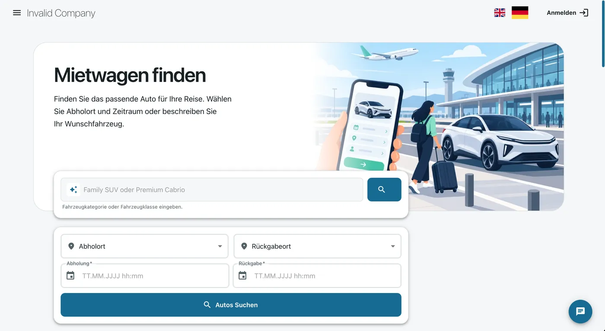

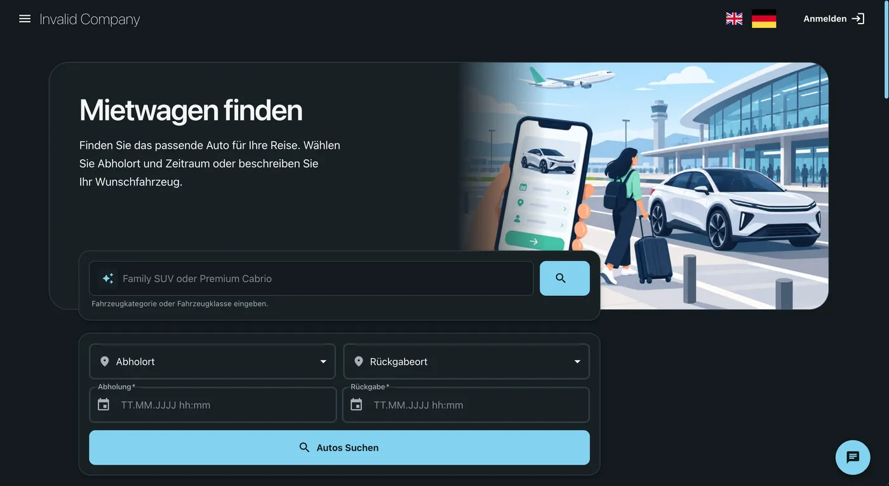

### LLM basierte Suche

1. Die Anfrage ist zum Beispiel Fahrzeugart, Ort und Mietzeitraum.
2. Die Suche zeigt dazu passende verfügbare Fahrzeuge.
3. Bei der Reservierung werden die im Suchtext erkannten Abhol- und Rückgabedaten übernommen.

#### Folgende Suchangaben werden unterstützt
Fahrzeugkategorie, Fahrzeugklasse, Abholort und vollständigem Zeitraum: Dabei sollte das Datum nicht in der Vergangenheit liegen.
„Ich möchte vom 15.10.2026 um 10:30 Uhr bis zum 20.10.2026 um 10:30 Uhr einen Premium SUV Coupe in Berlin mieten.“


**Aus markenrechtlichen Gründen, werden Automarken als Kategorien bezeichnet.**

Unterstützt werden:
- Kategorien: z. B. Premium SUV Coupe, Large SUV, City Compact, Premium Cabrio
- Fahrzeugklassen: Economy, Comfort, Premium, Sports Car, Electric Car
- Abholort
- Rückgabeort
- Abholzeit und Rückgabezeit
- Deutsch und Englisch

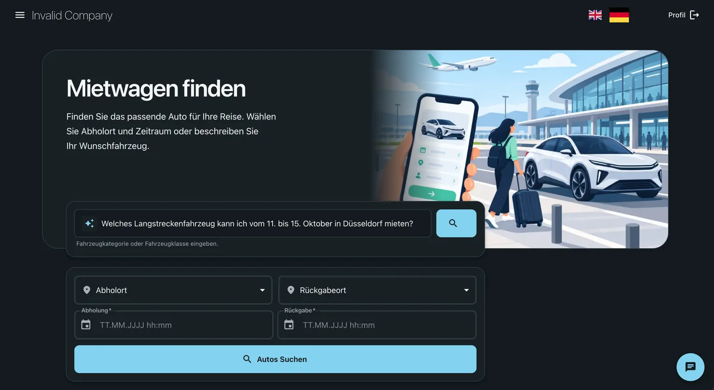

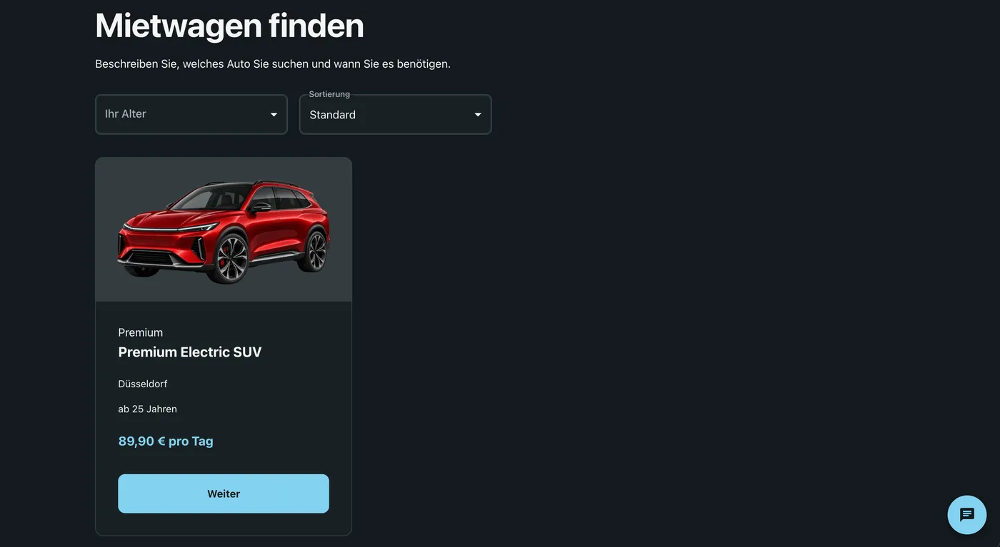

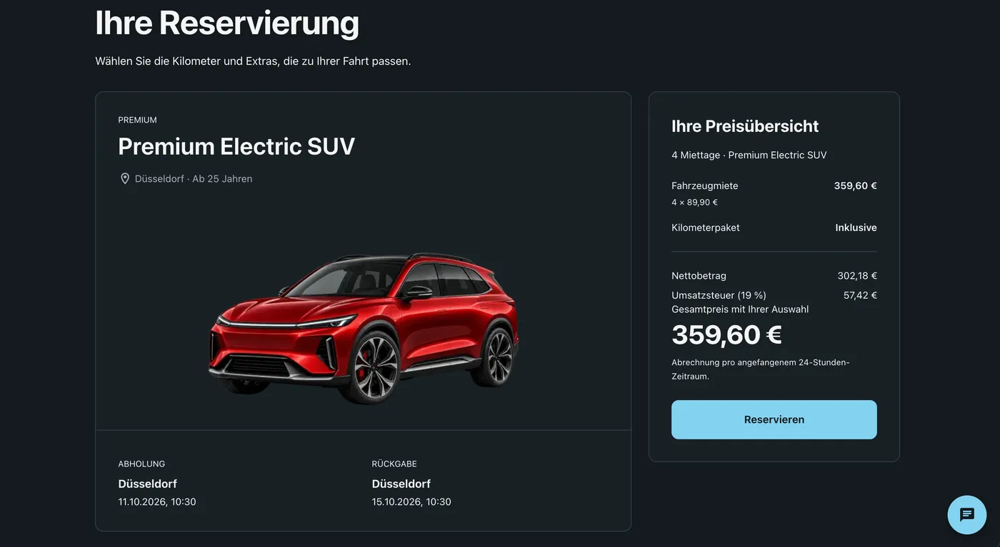

### PayPal-Bezahlung

Die Reservierung kann über den PayPal-Button bezahlt werden.

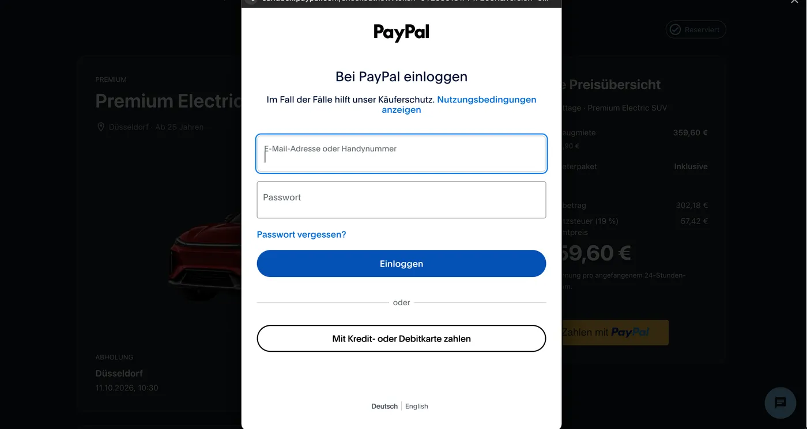
### Chrome developers

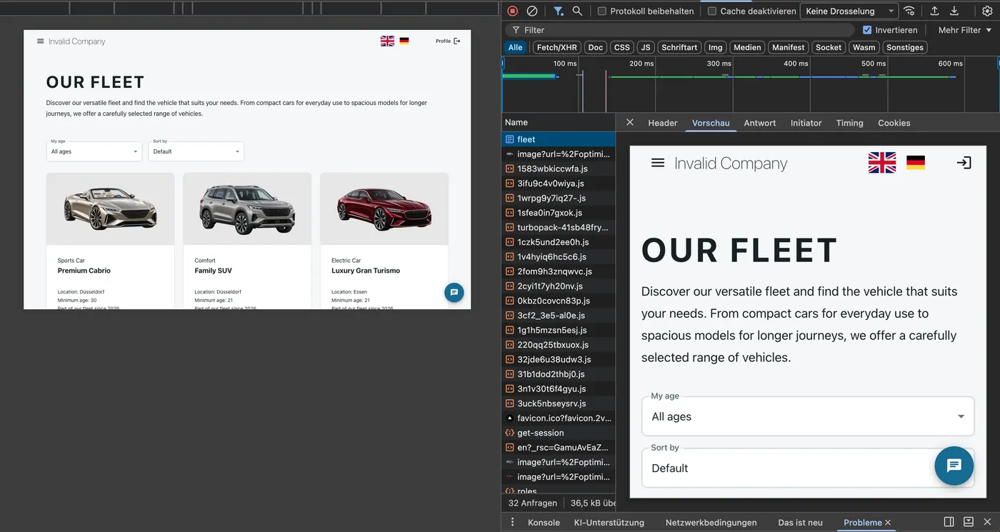
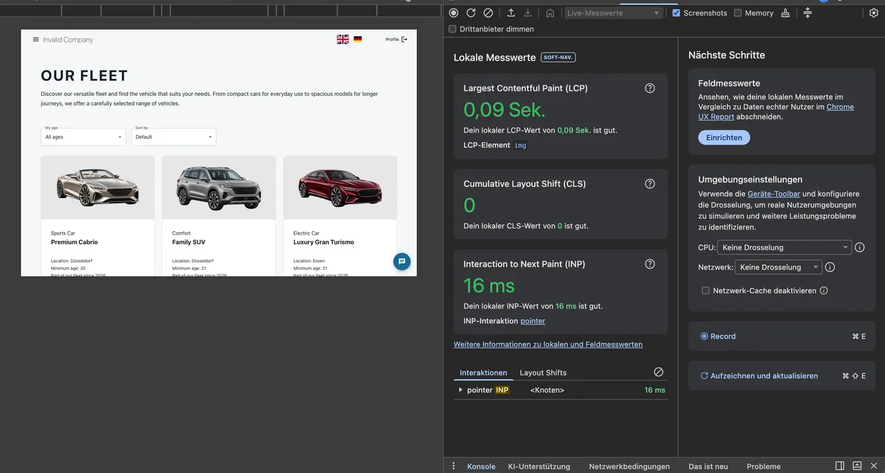
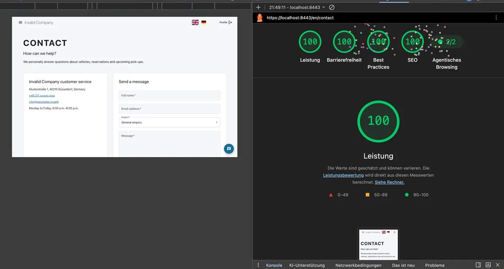
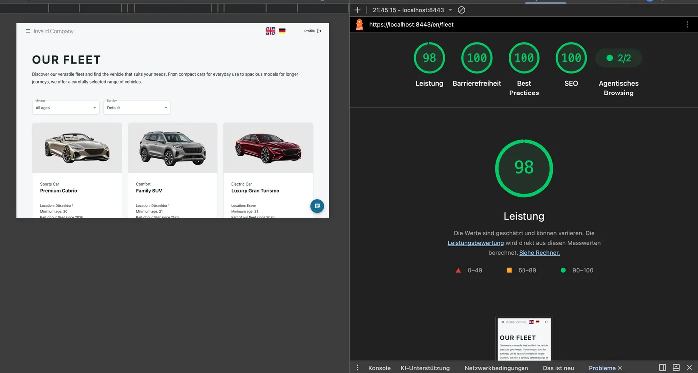
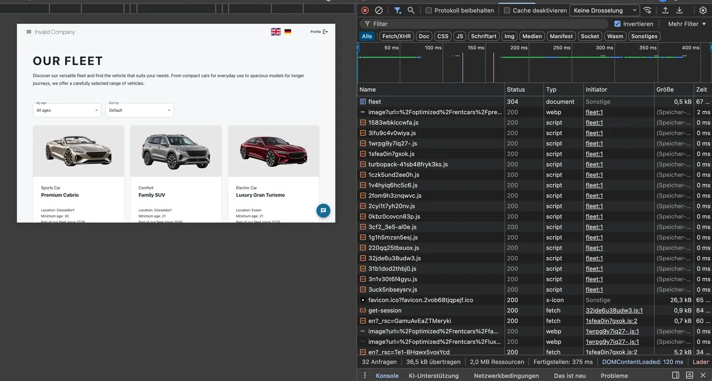
## Technik und Aufbau

| Bereich | Eingesetzte Technik |
| --- | --- |
| Frontend | Next.js, React, TypeScript, MUI, next-intl |
| Backend | Java, Spring Boot, Spring AI |
| Daten | PostgreSQL, pgvector, Kafka |
| Anmeldung | Keycloak, Better Auth |
| Infrastruktur | Docker Compose, Nginx, Ollama, Terraform und Floci als lokale S3-Emulation |
| Tests und CI | Maven-Tests, Playwright und GitHub Actions |

| Verzeichnis | Inhalt |
| --- | --- |
| [application/rag-app](application/rag-app) | Frontend, Authentifizierung und Server-Aktionen |
| [application/backend/carservice](application/backend/carservice) | Fahrzeuge, Suche, Reservierungen und Zahlungen |
| [application/backend/aiservice](application/backend/aiservice) | LLM basierte Suche, Chat und RAG |
| [application/backend/notificationservice](application/backend/notificationservice) | E-Mail-Benachrichtigungen und Rechnungs-PDFs |
| [application/backend/commonlib](application/backend/commonlib) | Gemeinsamer Backend-Code |
| [infrastructure](infrastructure) | Nginx, Keycloak, PostgreSQL und Terraform-Konfiguration |
| [e2e](e2e) | Playwright-Tests |

Der Stage-Stack betreibt jeweils drei Instanzen von app und carservice. Nginx verteilt die Anfragen auf diese Instanzen. Die Konfigurationen stehen in [compose.stage.yml](compose.stage.yml) und [compose.dev.yml](compose.dev.yml).

## Lokal starten

### Voraussetzungen und Konfiguration

- Docker
- Terraform Version 1.16.3
- Lokale TLS-Dateien befinden sich unter [infrastructure/nginx/certs/](infrastructure/nginx/certs/)

```bash
mkcert -install
mkcert -cert-file infrastructure/nginx/certs/local.crt -key-file infrastructure/nginx/certs/local.key localhost host.docker.internal
```

Für die optionale PayPal-Sandbox-Bezahlung werden in [env.dev](.env.dev) folgende Werte benötigt:

```dotenv
PAYPAL_CLIENT_ID=<Sandbox-Client-ID>
PAYPAL_CLIENT_SECRET=<Sandbox-Client-Secret>
PAYPAL_SANDBOX=true
```

Ohne Client-ID und Client-Secret ist die Bezahlfunktion nicht verfügbar.

### Stage-Stack starten

Im Projektverzeichnis ausführen:

```bash
./stage-build.sh
```

Mit der aktuellen Konfiguration sind folgende Dienste erreichbar:

| Dienst | Adresse |
| --- | --- |
| Anwendung | [https://localhost:8443/de](https://localhost:8443/de) |
| Keycloak | [https://localhost:8444](https://localhost:8444) |
| MailDev | [http://localhost:1080](http://localhost:1080) |

### Registrierung und Anmeldung

Neue Nutzer erhalten automatisch die Rolle user. Nach der Registrierung muss die E-Mail-Adresse bestätigt werden. Die Bestätigungsnachricht ist in MailDev abrufbar. Für eine Reservierung wird außerdem eine im Nutzerprofil gespeicherte Führerscheinnummer benötigt.

Für die lokale Demo ist folgendes Admin-Konto bereits vorhanden:

| Feld | Wert |
| --- | --- |
| E-Mail | hakan@test.de |
| Passwort | Hakan1$%& |

Dieses Konto ist für die lokale Demo vorgesehen.

### LLM einrichten

Als Admin anmelden und im Menü **AI-Provider** den Anbieter bzw. Inferenz-Plattform wählen, das Modell und den API-Schlüssel eintragen.

Für dieses Projekt wurde [Groq](https://console.groq.com/home) mit dem Modell **openai/gpt-oss-120b** verwendet. Andere LLMs wurden für die lokalen Tests nicht getestet. Wegen des begrenzten Arbeitsspeichers und der CPU-Leistung des verwendeten MacBook Pro M1 wurde das LLM über Groq betrieben.

Die Embeddings werden weiterhin lokal über Ollama mit dem Modell **bge-m3** erzeugt.

## RAG-Dokumente und Benachrichtigungen

Im Menü **RAG Edit** können PDFs hochgeladen werden. LLM liest die Dateien ein, teilt den Text in Chunks auf und erzeugt Embeddings. Die PDFs werden in S3 gespeichert, die Such-Chunks und Vektoren in PostgreSQL mit pgvector. Identische Dateiinhalte werden anhand eines SHA-256-Hashes erkannt.

Beim Ersetzen eines Dokuments werden die alten Such-Chunks durch neue ersetzt. Die vorherige PDF-Datei bleibt derzeit in S3 liegen und wird vom Dokumenteintrag nicht mehr verwendet.

Nach einer Reservierung versendet notificationservice eine Bestätigung per E-Mail. Nach erfolgreicher Bezahlung wird eine Rechnung verschickt. Die Ereignisse werden über Kafka übermittelt. Die E-Mails können lokal in MailDev gelesen werden. Dort erscheinen auch Nachrichten aus dem Kontaktformular.

AGB, Datenschutz- und Versicherungsdokumente sind im Footer in der jeweils gewählten Sprache verlinkt.

Chat und LLM basierte Suche haben getrennte Rate Limits. Aktuell gilt pro Funktion und Frontend-Prozess eine Anfrage pro Minute. Da der Limiter einen festen Schlüssel "const developmentIp = "127.0.0.1";" verwendet, teilen sich alle Nutzer einer Instanz dieses Limit.

## Tests und Performance

Backend-Tests befinden sich in den jeweiligen Maven-Modulen, End-to-End-Tests unter [e2e](e2e). Die Workflows in [.github/workflows](.github/workflows) führen Backend- und Playwright-Prüfungen aus.

Lokale Lasttests wurden mit Grafana k6 auf einem **MacBook Pro 2020 mit M1 und 8 GB RAM** ausgeführt. Ergebnisse stehen in [PERFORMANCE.md](PERFORMANCE.md). Diese Messungen beziehen sich auf die lokale Testumgebung. Die k6-Skripte liegen im lokalen Verzeichnis [k6](/k6/).

## Rechte und Lizenzen

- **Projektcode:** Dieses Portfolio erteilt keine Lizenz zur Weiterverwendung des selbst entwickelten Quellcodes. Eine kommerzielle Nutzung wird nicht gestattet.
- **iText:** notificationservice nutzt iText **5.5.13.6** zur PDF-Erzeugung. Die Bibliothek ist unter **AGPL-3.0** verfügbar Copyright © iText Software. [iText-Lizenz](https://github.com/itext/itextpdf/blob/develop/LICENSE.md).
- **Bilder und Dokumente:** Die Projektbilder befinden sich unter application/rag-app/public/optimized/. Die Anwendung stellt von Beginn an einen vollständigen und direkt nutzbaren Funktionsumfang bereit, deswegen werden die Bilder in [Public-Ordner](application/rag-app/public/optimized/rentcars/) gespeichert. Für Production ungeeignet. Im Mittelpunkt des Projekts stehen der LLM basierter Chat und die LLM basierte Fahrzeugsuche. Die PDFs befinden sich in [PDF-Dateien](application/rag-app/public/documents/). Die abgebildeten Autos und Marken sind fiktiv. Für diese Dateien wird keine Weiterverwendungslizenz erteilt.